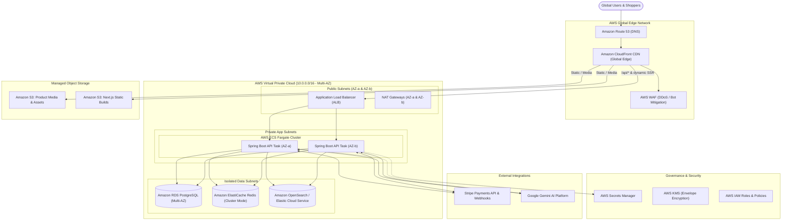

# ShopStream AWS Cloud Architecture Blueprint

This document details the production cloud topology for deploying **ShopStream** on Amazon Web Services (AWS) using high-availability, multi-AZ managed services.

---

## 1. Cloud Architecture Diagram

---

## 2. Infrastructure Components

### 2.1 Compute (AWS ECS Fargate)
- **Container Engine**: AWS Fargate (Serverless container runtime, eliminating EC2 management).
- **Auto-Scaling**: Target tracking policy scaling between 2 and 20 tasks based on CPU utilization (>70%) and ALB Request Count per Target (>1000 req/min).
- **Graceful Shutdown**: Spring Boot `server.shutdown=graceful` handles in-flight transactions before task termination.

### 2.2 Persistence (Amazon RDS for PostgreSQL)
- **Deployment**: Multi-AZ with automated synchronous replication to standby AZ.
- **Backups**: Automated daily snapshots with 35-day retention, point-in-time recovery (PITR) to 5-minute granularity.
- **Connection Pooling**: Managed with HikariCP on Spring Boot with RDS Proxy to handle sudden traffic surges without exhausting connection limits.

### 2.3 Caching & Session Storage (Amazon ElastiCache for Redis)
- **Engine**: Redis 7 with In-Transit & At-Rest Encryption.
- **Topology**: Replication Group with Multi-AZ automatic failover.
- **Use Case**: Sub-millisecond cart read/writes, distributed locks for Stripe idempotency keys (`idemp:*`), and rate-limiting counters.

### 2.4 Search & Analytics (Amazon OpenSearch / Elastic Cloud on AWS)
- **Cluster**: 3 Dedicated Master nodes + 3 Data nodes across multiple Availability Zones.
- **Index Lifecycle Management (ILM)**: Automated snapshotting, read-only replica scaling during high-traffic promotional periods.

### 2.5 Content Delivery & Assets (CloudFront + S3)
- **CloudFront**: TLS 1.3, HTTP/3 enabled, edge caching of static assets with S3 Origin Access Control (OAC).
- **Product Images**: Uploaded directly to S3 via pre-signed URLs with CloudFront global edge delivery.

---

## 3. Idempotency & Zero-Duplicate Charge Guarantee in AWS

1. **Client Header**: Requests hitting ALB pass `Idempotency-Key` down to ECS tasks.
2. **Distributed Redis Lock**: The task checks Redis with atomic `SETNX` (10-minute TTL).
3. **Database Audit Table**: PostgreSQL `idempotency_records` records `PROCESSING` status.
4. **Stripe Webhook Delivery**: When Stripe delivers webhooks to `/api/v1/payments/webhook`, the signature `Stripe-Signature` is verified. The webhook event ID `evt_xxx` is treated as an idempotency key. If an event is re-delivered, the server immediately returns HTTP 200 without charging or fulfilling twice.
